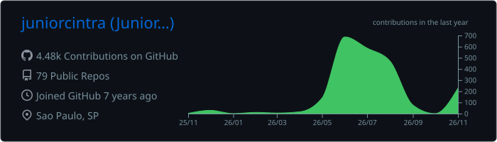
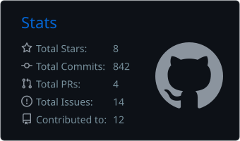
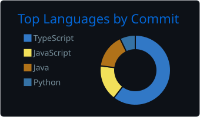

# Hi, I'm Sergio Cintra 👋
 
**Senior Software Engineer · AI Automation & Agents · Integrations · Data & Dashboards**
 
I build software that removes manual work and shows how the business is doing in real time: integrations between platforms, data pipelines, KPI dashboards and LLM-powered automations that run in production.
 
- 🏦 **Now:** Software Engineer at **Spassu**, building internal systems for **Caixa Econômica Federal** (Java/Quarkus + Next.js/TypeScript)
- 🤖 **Studying:** Postgraduate in **Applied AI Engineering** (360h): LLMs, RAG, agents and multi-agent systems, AI workflow automation, evals, AI governance
- 🚗 **Founder of VT3 Tech:** SaaS for vehicle dealerships, with paying clients in production
- 🎥 **DevFast:** content about software engineering, AI and developer productivity
- 🌎 Fluent in English, used to working with US-based teams. Open to remote and international roles.
---
 
## 🔭 Featured projects
 
| Project | What it does | Stack |
| --- | --- | --- |
| **[DR Ops Hub](https://github.com/juniorcintra/dr-ops-hub)** | Data and AI layer for a US direct-response (nutra) operation. Checkout webhooks (ClickBank, Digistore24, Stripe) with HMAC and idempotency, hourly media spend sync via n8n, and a SQL KPI layer (CPA, ROAS, AOV, LTV, chargebacks). Also includes a dashboard and a daily AI briefing where *SQL computes and the LLM explains*. | NestJS · Next.js 16 · Postgres · n8n · Metabase · OpenAI/Anthropic · Docker |
| **[AI Review Summary Agent](https://github.com/juniorcintra/modulo-engajamento-sistema-avaliacao-produto)** | Product review platform with an LLM agent that summarizes up to 200 reviews. It treats comments as data to resist prompt injection, and caches summaries to control cost. Built spec-driven with AI-assisted development. | Next.js · Mastra.ai · OpenAI · tRPC · Zod · Supabase |
| **[A2 Automóveis](https://www.a2automoveis.com.br/)** (VT3 Tech) | Dealer platform in production: public catalog with filters and reservations, customer area, and an admin with a KPI dashboard, leads, inventory, photo upload and a scheduled reservation-expiry job. | Next.js 16 · NestJS 11 · Prisma · PostgreSQL · AWS S3 · Docker |
 
---
 
## 📈 Selected results
 
- **+100% in Core Web Vitals** (LCP, CLS, TTI) on the e-commerce platform of Mistral, Brazil's leading wine retailer, as Tech Lead (Next.js 15, React 19)
- **~40% faster scheduling** on a resource-management platform (Carsystem)
- **~30% more efficient internal processes** after modernizing legacy systems at ABDI, the Brazilian Industrial Development Agency
- **Real-time transaction monitoring and fraud alerts** on a high-criticality banking system (FDTE)
---
 
## 🛠️ Tech stack
 
**AI & Automation**
 

 
**Backend**
 

 
**Frontend**
 

 
**Data & BI**
 

 
**Cloud & DevOps**
 

 
---
 
## 💼 Experience
 
| Period | Company | Role | Highlights |
| --- | --- | --- | --- |
| 2025 – now | **Spassu** / **Qintess** | Software Engineer | Critical internal systems for Caixa Econômica Federal (Java/Quarkus, Next.js) |
| 2025 | **Webeleven** | Tech Lead | Frontend lead on the Mistral e-commerce: architecture, code reviews, +100% Core Web Vitals |
| 2024 – 2025 | **Engesoftware** | Senior Full Stack Developer | Legacy modernization for ABDI (React, Next.js, Laravel, PostgreSQL) |
| 2024 | **Carsystem** | Senior Frontend Developer | Scheduling platform, 40% faster scheduling |
| 2023 – 2024 | **Lingo For Me** (USA) | Frontend Developer | Full refactor of the React Native and React apps; shared architecture with Redux |
| 2020 – 2024 | **D&D Group · Stoom · KotaKi · FDTE** | Frontend / Full Stack | Decision-support tools, e-commerce, retail apps, banking system with fraud monitoring |
| 2019 – 2020 | **City Connect · Foco · Zemis · Interagir** | Full Stack Developer | Custom web and mobile systems for clients such as Unimed and Procon |
 
Full details on [LinkedIn](https://www.linkedin.com/in/sergio-cintra-developer/).
 
---
 
## 🎓 Education
 
- **Postgraduate in Applied AI Engineering** (in progress, expected 2027)
- **MBA in Full Stack Development**, Rocketseat + SIRIUS (2024–2025)
- **B.Sc. in Information Systems**, UGB (2017–2020)
- **IT Technician**, Colégio ICT (2013–2015)
---
 
## 📊 GitHub stats
 

 

 
---
 
## 📫 Let's talk
 

 
*Technology only creates value when it solves real problems. That's what I build for.*
 
